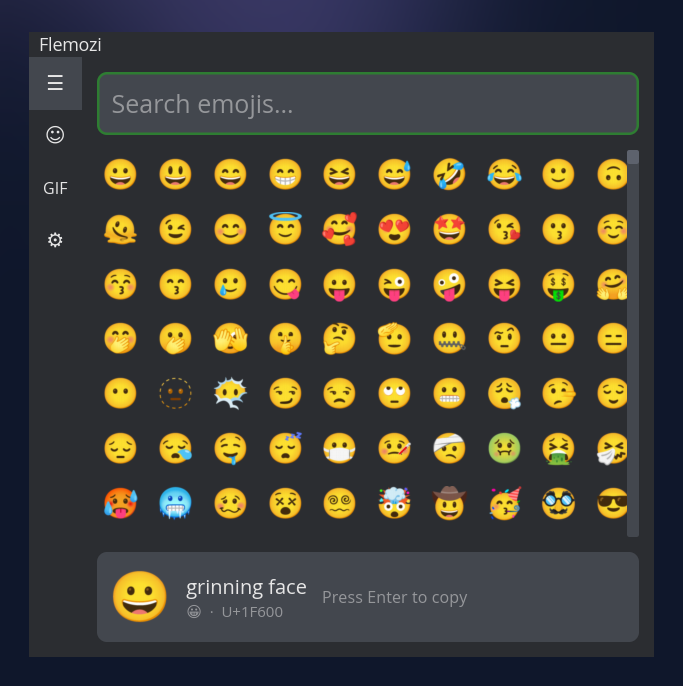

<p align="center"></p>
<h1 align="center">Flemozi for Arch Linux</h1>

<p align="center">
  A fast, lightweight emoji, emoticon and GIF picker — packaged for Arch Linux.
</p>

This is a fork of [KRTirtho/flemozi](https://github.com/KRTirtho/flemozi) (the
Rust/[iced](https://iced.rs/) rewrite) that adds a Linux backend and a local
Arch package. The `flemozi` package on the AUR builds the old Flutter version
and no longer builds.

Tested on CachyOS / KDE Plasma (Wayland).



## Build & install

```sh
git clone https://github.com/lyubomirhristovv/flemozi.git
cd flemozi
echo 'KLIPY_API_KEY=<your key>' > .env   # optional, enables the GIF tab
packaging/arch/build-and-install.sh
```

The script installs missing build dependencies (`base-devel`, `rustup`, `gtk3`,
`libayatana-appindicator`, …), builds the package with `makepkg`, and installs
it with `sudo pacman -U`. If Flemozi is running, it is restarted.

| Option         | Effect                                        |
| -------------- | --------------------------------------------- |
| `--no-install` | Only build; package lands in `packaging/arch/` |
| `--clean`      | Discard cached build output (full rebuild)    |

To update, `git pull` and run the script again. To uninstall:
`sudo pacman -R flemozi`.

### GIF API key

The GIF tab uses [Klipy](https://klipy.com). Create a free app key at
<https://partner.klipy.com> and put it in `.env` **before building** — it is
embedded into the binary. Alternatively export `KLIPY_API_KEY` at runtime.
`.env` is gitignored.

## Usage

- Launch **Flemozi** from the app menu, or run `flemozi`. It lives in the tray.
- **Shortcut:** Wayland does not allow apps to grab global hotkeys. In
  *System Settings → Keyboard → Shortcuts → Add New → Command*, add
  `flemozi --toggle` and bind it (e.g. <kbd>Ctrl</kbd>+<kbd>Alt</kbd>+<kbd>.</kbd>).
  On X11 the built-in shortcut (<kbd>Ctrl</kbd>+<kbd>Alt</kbd>+<kbd>.</kbd>) also works.
- Type to search, arrow keys to move, <kbd>Enter</kbd> to pick, <kbd>Esc</kbd> to close.
- The pick is copied to the clipboard. For automatic pasting into the previous
  window install one of:
  - `ydotool` (Wayland, any compositor; needs `ydotoold` running), or
  - `wtype` (wlroots compositors), or
  - `xdotool` (X11).

  Otherwise just press <kbd>Ctrl</kbd>+<kbd>V</kbd>.
- **Settings → Launch at startup** writes `~/.config/autostart/flemozi.desktop`
  (starts hidden in the tray).
- Follows the system light/dark theme.

| CLI flag   | Effect                                         |
| ---------- | ---------------------------------------------- |
| `--toggle` | Show/hide the picker of the running instance   |
| `--show`   | Show the picker (default when already running) |
| `--hidden` | Start in the tray without opening the picker   |

Config: `~/.config/flemozi/config.json`.

## Development

```sh
cargo run      # debug build; needs the same deps as above
```

See [AGENTS.md](AGENTS.md) for architecture notes.

## Credits & license

Original app by Kingkor Roy Tirtho ([@KRTirtho](https://github.com/KRTirtho)).
Emoji rendering uses [Noto Color Emoji](https://github.com/googlefonts/noto-emoji).

Licensed under the [GPLv3](LICENSE).
